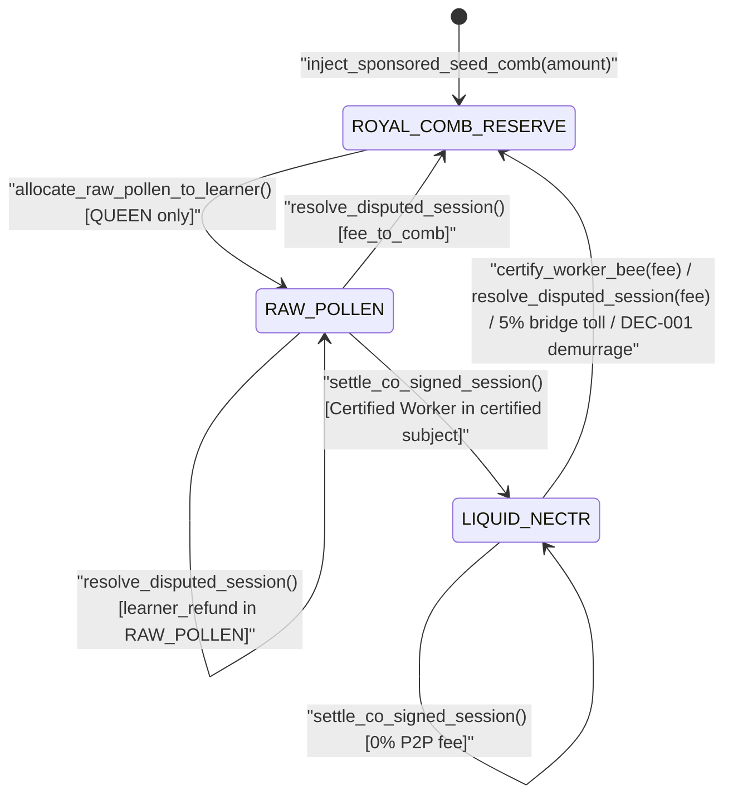
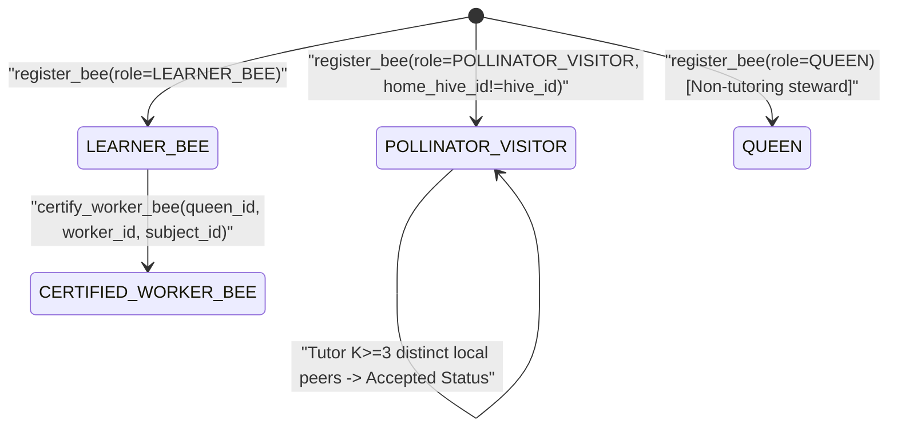
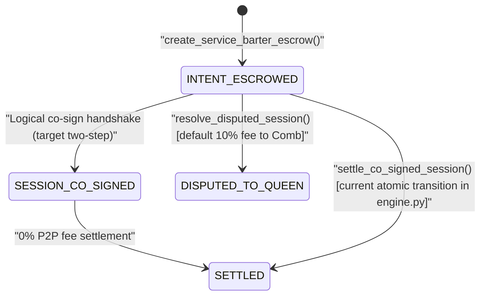

# Smart Contracts Specification

All five deterministic smart contracts execute inside `src/nectr/contracts/engine.py` (`HiveContractEngine`) using pure Python standard library primitives (`dataclasses`, `enum.StrEnum`, `typing`), with zero database, HTTP, or telemetry dependencies. Any invariant violation raises `ContractViolationError(ValueError)`. Refer to [System Design](system_design.md) for C4 deployment topology and the [Domain Glossary](../glossary.md) for ubiquitous language definitions (`DEC-008`).

## Core Domain Entities and Enums

### Dataclasses (`src/nectr/contracts/engine.py`)

- **`BeeAccount`:**
  - `bee_id: str`
  - `home_hive_id: str`
  - `role: BeeRole = BeeRole.LEARNER_BEE`
  - `raw_pollen_balance: float = 0.0`
  - `liquid_nectr_balance: float = 0.0`
  - `certified_subjects: set[str]`
  - `accepted_in_hives: set[str]` (initialized to `{home_hive_id}` on `register_bee`)
  - `distinct_peers_tutored_in_hive: set[str]`
  - `royal_jelly_earned: float = 0.0`
- **`ServiceBarterSession`:**
  - `session_id: str`, `hive_id: str`, `tutor_id: str`, `learner_id: str`, `subject_id: str`, `duration_hours: float`, `escrowed_amount: float`, `token_state: TokenState`
  - `reciprocal_subject_id: str | None = None`
  - `status: SessionStatus = SessionStatus.INTENT_ESCROWED`
  - `learner_attestation_score: float = 0.0`, `tutor_comprehension_hash: str = ""`, `effective_weight: float = 0.0`
- **`HiveContractEngine` Constructor & State Maps:**
  - `__init__(self, hive_id: str, collusion_alpha: float = 1.5, lineage_gamma: float = 0.5, accepted_status_peer_threshold: int = 3) -> None` (`DEC-003`)
  - Tracked state: `comb_reserve: float`, `total_minted_supply: float`, `accounts: dict[str, BeeAccount]`, `sessions: dict[str, ServiceBarterSession]`, `pairwise_counts: dict[frozenset[str], int]`, `subject_lineage: dict[tuple[str, str], list[str]]`, `tutor_effectiveness: dict[str, float]`, `settled_tx_log: list[dict[str, Any]]`.

## State Machine Diagrams

### TokenState Lifecycle (`TokenState` Enum)



### BeeRole and Governance Tiers (`BeeRole` Enum + ADR-0003)



- **Governance Tier Note ([ADR-0003](../adr/0003-enforce-multi-tier-beekeeper-and-queen-governance.md)):** `BeeRole` in `src/nectr/contracts/engine.py` currently defines four enum members: `LEARNER_BEE`, `CERTIFIED_WORKER_BEE`, `POLLINATOR_VISITOR`, and `QUEEN`. The institutional **`Beekeeper`** authority (logged emergency override and bond-slashing over Hives) is a locked architectural tier in `ADR-0003` not yet added as a `BeeRole` enum member in code.

### SessionStatus Lifecycle (`SessionStatus` Enum)



- **Code vs. Enum Note:** `SessionStatus.SESSION_CO_SIGNED` is defined in `src/nectr/contracts/engine.py`, while `settle_co_signed_session()` currently executes co-signing and settlement atomically from `INTENT_ESCROWED` directly to `SETTLED`.

## Detailed Contract Specifications

### 1. TokenStateAndCombContract

Manages closed-loop supply creation, `RAW_POLLEN` voucher issuance, and global accounting conservation ([ADR-0002](../adr/0002-enforce-directional-service-barter-state-transitions.md), [ADR-0006](../adr/0006-adopt-two-phase-hive-genesis-and-autonomous-swarming.md)).

#### TokenStateAndCombContract Implemented Methods

- `register_bee(bee_id: str, role: BeeRole = BeeRole.LEARNER_BEE, home_hive_id: str | None = None) -> BeeAccount` — Idempotent registration; sets `accepted_in_hives = {origin}` where `origin` defaults to `self.hive_id`.
- `inject_sponsored_seed_comb(amount: float) -> dict[str, Any]` — Requires `amount > 0`; increments both `self.comb_reserve` and `self.total_minted_supply`.
- `allocate_raw_pollen_to_learner(queen_id: str, learner_id: str, amount: float) -> dict[str, Any]` — Requires `_require_queen(queen_id)`; forbids `learner.role == BeeRole.QUEEN`; requires `0 < amount <= self.comb_reserve`; transfers `comb_reserve -> learner.raw_pollen_balance` and verifies supply conservation.
- `assert_supply_conservation() -> None` — Verifies within `1e-4` rounding tolerance (`round(..., 5)`):

$$M_{\text{total}} = S_{\text{comb}} + \sum_{a \in A} B_{\text{pollen}}(a) + \sum_{a \in A} B_{\text{nectR}}(a) + \sum_{s \in \mathcal{E}_{\text{active}}} E_s$$

where $\mathcal{E}_{\text{active}}$ is the set of sessions in `SessionStatus.INTENT_ESCROWED`.

#### TokenStateAndCombContract Locked Lifecycle Specifications

- **Lazy Demurrage (`DEC-001`):** Target protocol rule applying `~2%/month` melt only above a protected student safety buffer during Weeks 1–13, paused during Finals (Weeks 14–15), tunable per Hive by Queens/Beekeepers and routed to `ROYAL_COMB_RESERVE`.
- **Senior Graduation Sinks (`DEC-004`, `ADR-0006`):** Target exit split of `40%` Credentials/Swarming grants, `35%` Campus Perks, `25%` Freshman Pay-It-Forward Bounties, plus dormant alumni sweeps back to `Comb`.

### 2. DirectionalServiceBarterContract

Enforces directional tutoring handshakes and prohibits blind token transfers ([ADR-0002](../adr/0002-enforce-directional-service-barter-state-transitions.md)).

#### DirectionalServiceBarterContract Implemented Methods and Invariants

- `create_service_barter_escrow(session_id: str, tutor_id: str, learner_id: str, subject_id: str, duration_hours: float, amount: float, token_state: TokenState = TokenState.LIQUID_NECTR, reciprocal_subject_id: str | None = None) -> ServiceBarterSession`
  - **No Self-Tutoring:** `tutor_id == learner_id` raises `ContractViolationError`.
  - **Queen Ban:** `tutor.role == BeeRole.QUEEN` raises `ContractViolationError`.
  - **Non-Negative & `0-nectR` Reciprocal Barter:** `amount < 0` is rejected; `amount == 0` requires non-empty `reciprocal_subject_id`.
  - **Token Partition Rules:** `RAW_POLLEN` is valid ONLY if `tutor.role == BeeRole.CERTIFIED_WORKER_BEE` and `subject_id in tutor.certified_subjects`; `LIQUID_NECTR` can pay any non-Queen tutor; `ROYAL_COMB_RESERVE` cannot enter P2P escrow.
  - Deducts `amount` from learner balance into `ServiceBarterSession(status=INTENT_ESCROWED)` and calls `assert_supply_conservation()`.
- `settle_co_signed_session(session_id: str, learner_attestation_score: float, tutor_comprehension_hash: str) -> dict[str, Any]`
  - Requires `session.status == SessionStatus.INTENT_ESCROWED` and `0.0 <= learner_attestation_score <= 1.0`.
  - **Zero-Fee Trophallaxis Refinement:** Credits `tutor.liquid_nectr_balance += session.escrowed_amount` with `fee_charged: 0.0` (refining `RAW_POLLEN` into `LIQUID_NECTR`), updates Knowledge Graph weights, sets `status = SessionStatus.SETTLED`, verifies `assert_supply_conservation()`, and appends to `settled_tx_log`.

#### DirectionalServiceBarterContract Locked Surge Specification (`DEC-002`)

- **Comb Waggle Surge Co-Pay (`DEC-002`):** Target peak-demand mechanism where the Comb co-pays `~60%` of `~2.2x` Midterm/Finals tutor payouts so learners pay `~1.0x–1.3x` (Queen/Beekeeper tunable).

### 3. QueenGovernanceContract

Enforces separation of powers, routes `100%` of governance fees to the Comb, and governs Royal Jelly alignment ([ADR-0003](../adr/0003-enforce-multi-tier-beekeeper-and-queen-governance.md), [ADR-0004](../adr/0004-route-governance-fees-to-comb-with-phase-split-royal-jelly.md)).

#### QueenGovernanceContract Implemented Methods and Invariants

- `certify_worker_bee(queen_id: str, worker_id: str, subject_id: str, certification_fee: float = 0.0) -> dict[str, Any]`
  - Calls `_require_queen(queen_id)` and rejects `worker.role == BeeRole.QUEEN`.
  - If `certification_fee > 0`, deducts from `worker.liquid_nectr_balance` directly into `self.comb_reserve`.
  - Sets `worker.role = BeeRole.CERTIFIED_WORKER_BEE` and adds `subject_id` to `worker.certified_subjects`; calls `assert_supply_conservation()`.
- `resolve_disputed_session(queen_id: str, session_id: str, tutor_share_ratio: float, service_fee_rate: float = 0.10) -> dict[str, Any]`
  - Calls `_require_queen(queen_id)`; requires `session.status == SessionStatus.INTENT_ESCROWED` and `0.0 <= tutor_share_ratio <= 1.0`.
  - Computes `fee_to_comb = round(session.escrowed_amount * service_fee_rate, 6)` -> `100%` to `self.comb_reserve`.
  - Splits `distributable = session.escrowed_amount - fee_to_comb` into `tutor_payout = round(distributable * tutor_share_ratio, 6)` (`LIQUID_NECTR`) and `learner_refund = round(distributable - tutor_payout, 6)` (refunded in the session's original `token_state`: `RAW_POLLEN` or `LIQUID_NECTR`).
  - Sets `session.status = SessionStatus.DISPUTED_TO_QUEEN` and calls `assert_supply_conservation()`.

#### Royal Jelly Reconciliation and Open Simulation Caveat

- **Implemented Baseline (`HiveServiceLayer.mine_epoch_block(queen_dividend_beta=0.05)`):** Sets each Queen's non-monetary score `acct.royal_jelly_earned = round(queen_dividend_beta * proof.collusion_discounted_velocity * (1.0 - proof.gini_coefficient), 4)`.
- **Target Phase-Split Model (`ADR-0004`):** Phase 1 Teacher-Queens earn non-coin institutional impact credits; Phase 2 Veteran Student-Queens earn bond-backed `LIQUID_NECTR` dividends tied to Comb growth ($\Delta S_{\text{comb}}^+$), velocity, and low dispute rates, slashable by `Beekeeper` (`ADR-0003`).
- **Open Simulation Caveat (`EXP-001`):** Receiver-only Queen praise weights remain unlocked (`open-simulation`) until simulated across Honest vs. Biased nepotism arms.

### 4. KnowledgeGraphAndPolicingContract

Executes inside `settle_co_signed_session()` (`src/nectr/contracts/engine.py`) to attenuate Sybil roommate rings and reward downstream Learn-then-Teach cascades (`DEC-003`).

#### KnowledgeGraphAndPolicingContract Formulas and State Updates

**Step 1 — Pairwise Collusion Decay:**

$$\text{decay\_factor} = \frac{1}{1 + \alpha \cdot N_{\text{prior}}}$$

where $\alpha = \text{collusion\_alpha} = 1.5$ (default) and $N_{\text{prior}} = \text{pairwise\_counts}[\text{frozenset}(\{\text{tutor}, \text{learner}\})]$.

**Step 2 — Downstream Lineage Bonus:**

$$\text{lineage\_bonus} = 1 + \begin{cases} \gamma & \text{if } \text{subject\_lineage}[(\text{tutor}, \text{subject})] \neq \emptyset \\ 0 & \text{otherwise} \end{cases}$$

where $\gamma = \text{lineage\_gamma} = 0.5$ (default, yielding `1.5` with upstream tutors and `1.0` otherwise).

**Step 3 — Effective Session Weight & Pairwise Counter:**

$$\text{effective\_weight} = s_{\text{att}} \cdot \text{decay\_factor} \cdot \text{lineage\_bonus}$$

where $s_{\text{att}} = \text{learner\_attestation\_score} \in [0.0, 1.0]$. `pairwise_counts[pair_key]` increments by `1`.

**Step 4 — First-Pair Quality Gate (`prior_pair_txs == 0` and `learner_attestation_score >= 0.6`):**

- Appends `tutor_id` to `subject_lineage[(learner_id, subject_id)]`.
- Adds `learner_id` to `tutor.distinct_peers_tutored_in_hive`.
- Credits each `upstream_id` in `upstream_tutors` with `+ 0.25 * effective_weight` in `tutor_effectiveness`.

**Step 5 — Tutor Effectiveness & Guard Bee Unlock:**

- Adds `+ effective_weight` to `tutor_effectiveness[tutor_id]`.
- When `len(tutor.distinct_peers_tutored_in_hive) >= accepted_status_peer_threshold` (default `3` per `DEC-003`; `src/nectr/personas/simulator.py` overrides to `2` for its compact multi-hive scenario), adds `self.hive_id` to `tutor.accepted_in_hives`.

### 5. GuardBeeCrossHiveBridgeContract

Prevents cross-Hive capital flight and inflation contagion by gating Comb-to-Comb transfers on host-Hive contribution and clamped health exchange rates ([ADR-0005](../adr/0005-gate-cross-hive-bridges-with-guard-bee-status-and-epoch-fx.md), `DEC-003`, `DEC-004`).

#### GuardBeeCrossHiveBridgeContract Method and FX Formulas

Method: `bridge_nectr_to_target_hive(bee_id: str, target_hive: HiveContractEngine, amount: float, bridge_toll_rate: float = 0.05) -> dict[str, Any]`

- **Role & Balance Gates:** Rejects `source_acct.role == BeeRole.QUEEN` and requires `0 < amount <= source_acct.liquid_nectr_balance`.
- **Guard Bee Accepted Status Gate:** Calls `target_hive.register_bee(bee_id, home_hive_id=source_acct.home_hive_id)` and rejects unless `target_hive.hive_id in target_acct.accepted_in_hives`.
- **Burn/Mint Settlement & Dual Conservation:**
  - `source_toll = round(amount * bridge_toll_rate, 6)` (`5%` default) -> added to `self.comb_reserve`.
  - `net_out = amount - source_toll` -> subtracted from `self.total_minted_supply` (`source_acct.liquid_nectr_balance -= amount`).
  - Calls `self.assert_supply_conservation()`.
  - Mints `minted_in_target = round(net_out * exchange_rate, 6)` into `target_acct.liquid_nectr_balance` and `target_hive.total_minted_supply`.
  - Calls `target_hive.assert_supply_conservation()`.
- **Target Outflow Cap (`ADR-0005`):** A per-epoch monthly outflow cap is specified in `ADR-0005` as a target cross-Hive throttling extension.

**Epoch Health FX Clamp (`DEC-004`):**

$$h_{\text{src}} = \max\!\left(\frac{S_{\text{comb, src}}}{\max(|A_{\text{src}}|, 1)}, 1.0\right), \quad h_{\text{dst}} = \max\!\left(\frac{S_{\text{comb, dst}}}{\max(|A_{\text{dst}}|, 1)}, 1.0\right)$$

$$r_{\text{FX}} = \min\!\left(\max\!\left(\frac{h_{\text{src}}}{h_{\text{dst}}}, 0.5\right), 2.0\right)$$

#### Contract-Level Bridge Sequence Flow

```mermaid
sequenceDiagram
    participant Caller as "Pollinator / Service Caller"
    participant Source as "HiveContractEngine (Source)"
    participant Target as "HiveContractEngine (Target)"

    Caller->>Source: bridge_nectr_to_target_hive(bee_id, target_hive, amount, 0.05)
    Source->>Source: Assert role != QUEEN & balance >= amount
    Source->>Target: register_bee(bee_id, home_hive_id=source_acct.home_hive_id)
    Source->>Target: Assert target_hive.hive_id in target_acct.accepted_in_hives
    Source->>Source: Compute exchange_rate = clamp(source_health / target_health, 0.5, 2.0)
    Source->>Source: source_toll -> comb_reserve; burn net_out from total_minted_supply
    Source->>Source: assert_supply_conservation()
    Source->>Target: Credit round(net_out * exchange_rate, 6) to balance & total_minted_supply
    Target->>Target: assert_supply_conservation()
    Source-->>Caller: Return CROSS_HIVE_BRIDGE dict
```

## Reconciliation of the Five Logical Service Interfaces

The architecture skill specification (`.agents/skills/blockchain-architect/references/contracts_and_services_spec.md`) defines five logical service boundaries. In `src/nectr/services/hive_service.py`, orchestration is consolidated in `HiveServiceLayer`, while Wave 1 ([ADR-0009](../adr/0009-adopt-sqlmodel-alembic-structlog-and-opentelemetry.md)) introduces hexagonal ports and adapters.

| Logical Service Interface | Implemented Mapping (`src/nectr/`) | Wave 1 Target Adapter / Exposure (`ADR-0009`) |
|---|---|---|
| `HiveNodeService` | `HiveServiceLayer.__init__()`, `bootstrap_sponsored_hive()`, `mine_epoch_block()` + `HiveBlockchain` | `HiveRepositoryPort` (`ports.py`), `SQLModelHiveRepository` (`persistence.py`), `src/nectr/services/migrations/`, `FastAPIHiveRouter` (`api.py`) |
| `BarterEscrowService` | `HiveServiceLayer.execute_tutoring_handshake()` -> `create_service_barter_escrow()` + `settle_co_signed_session()` + `blockchain.submit_transaction()` | `FastAPIHiveRouter` command route + atomic SQLModel commit / rollback on `ContractViolationError` |
| `GraphTelemetryService` | `HiveServiceLayer.compute_useful_work_proof()`, `compute_gini_coefficient()` | `TelemetryPort` (`ports.py`) -> `TelemetryAdapter` (`telemetry.py` using `structlog` + `opentelemetry-sdk`) + read-only UI feed (`ADR-0011`) |
| `QueenArbitrationService` | `HiveContractEngine.allocate_raw_pollen_to_learner()`, `certify_worker_bee()`, `resolve_disputed_session()` | Expose Queen allocation/arbitration commands via `HiveServiceLayer` and `FastAPIHiveRouter` (currently invoked directly on `contracts` in `personas/simulator.py`) |
| `CrossHiveBridgeService` | `HiveContractEngine.bridge_nectr_to_target_hive()` + `blockchain.submit_transaction()` | Expose bridge execution via `HiveServiceLayer` and `FastAPIHiveRouter` (currently invoked directly on `hive_a.contracts` in `personas/simulator.py`) |
