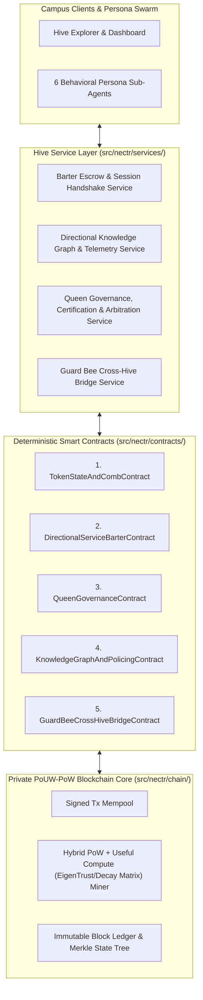

# Flagship System Design: Private PoUW-PoW Blockchain & Hive Service Layer

This architecture serves as the **System Design Portfolio Highlight** for **nectR**, separating the distributed consensus layer, the deterministic smart contract state machine, and the hexagonal Hive Service Layer.

## Key System Design Highlights

1. **Hybrid Proof-of-Useful-Work (`PoUW-PoW`):** Mining nodes secure block immutability via cryptographic hashing *and* compute the trailing epoch's directional knowledge flow matrix and pairwise collusion decay root.
2. **Hexagonal Service Layer:** Decouples fast off-chain session matching and telemetry queries from on-chain state settlement.
3. **Deterministic State Machine Contracts:** Zero external oracle dependency; every state transition is verifiable from signed directional session handshakes.
