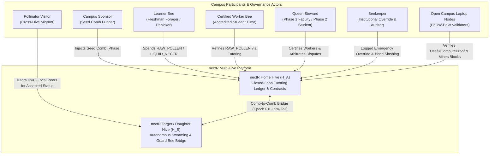
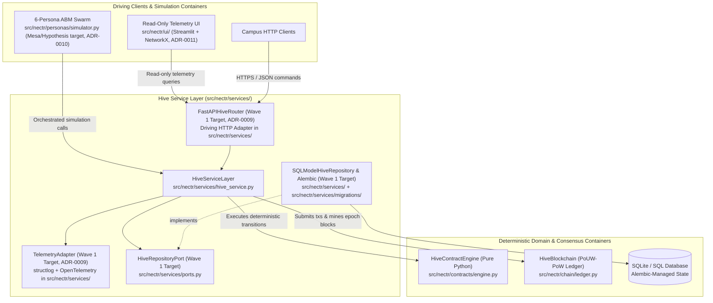
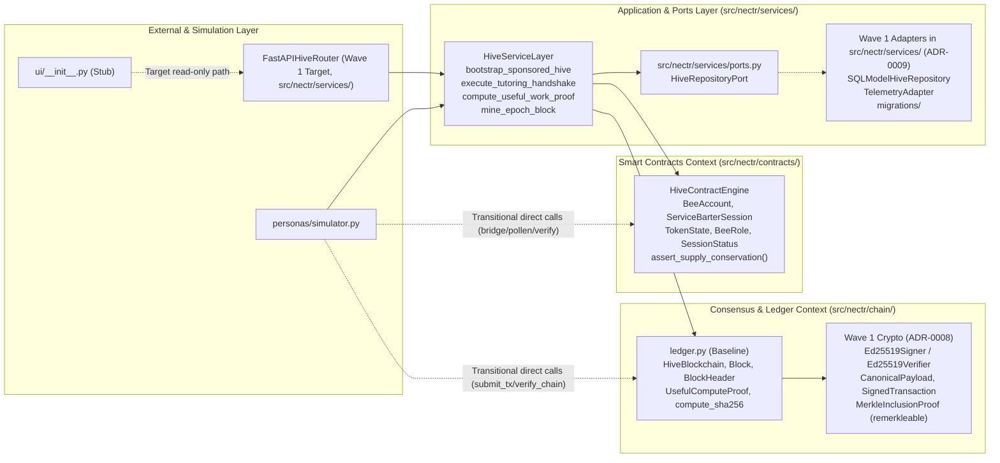
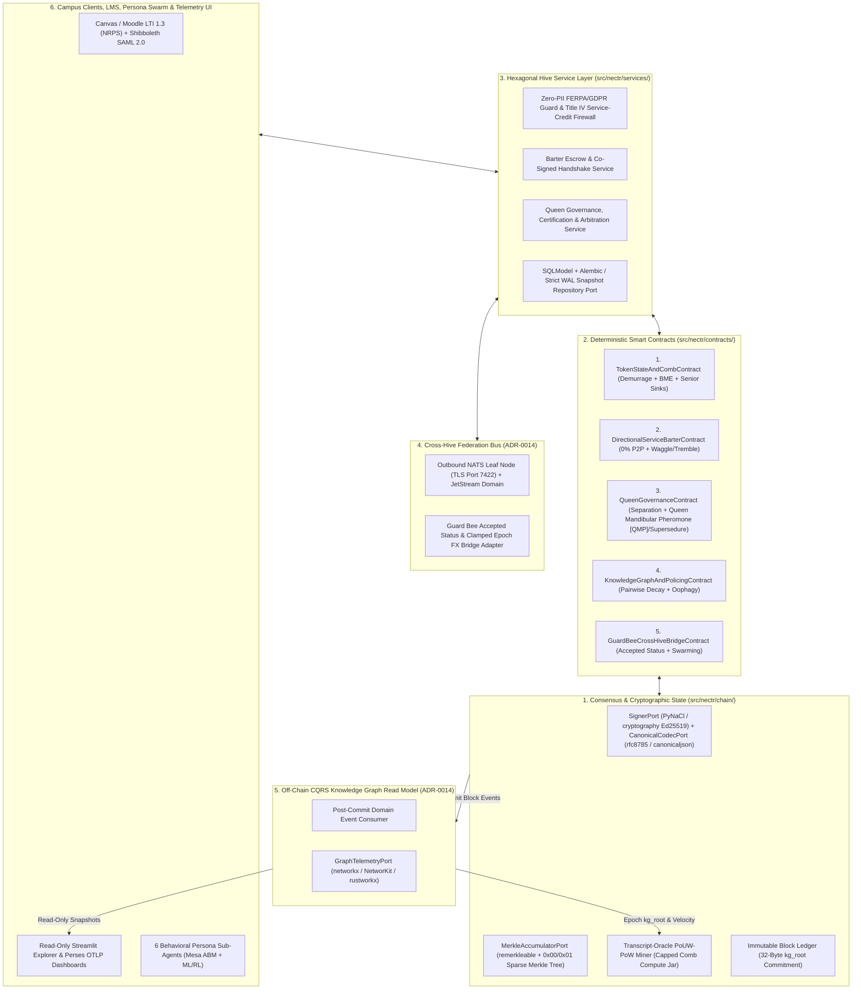

# Flagship System Design: Private PoUW-PoW Blockchain and Hive Service Layer

This architecture defines **nectR**'s closed-loop, peer-to-peer campus tutoring platform, separating cryptographic consensus (`src/nectr/chain/`), deterministic smart contract state machines (`src/nectr/contracts/`), and the hexagonal application layer (`src/nectr/services/`). Domain acronyms (`MV = PQ`, `PoUW-PoW` = Proof-of-Useful-Work plus Proof-of-Work) and ubiquitous language terms are defined in the [Domain Glossary](../glossary.md) per `DEC-008`; `FX` denotes the cross-Hive Foreign Exchange rate (`[0.5x, 2.0x]`).

Throughout this specification, **Implemented Baseline** denotes code currently present in `src/nectr/`, **Wave 1 Target Interfaces** denotes contracts/adapters specified in amended [ADR-0008](../adr/0008-adopt-ed25519-canonicaljson-and-merklelib.md) and [ADR-0009](../adr/0009-adopt-sqlmodel-alembic-structlog-and-opentelemetry.md), and **Locked Protocol Specifications** denotes economic rules in `DEC-001`–`DEC-004` and `ADR-0003`–`ADR-0007` scheduled across implementation waves.

## Architectural Principles

1. **No Blind Token Transfers ([ADR-0002](../adr/0002-enforce-directional-service-barter-state-transitions.md)):** Every peer transfer executes through `DirectionalServiceBarterContract` (`Tutor -> Learner`, `Subject`, `Duration`, co-signed `Attestation`, or `0-nectR` reciprocal skill barter) or an explicit `ROYAL_COMB_RESERVE` (`Comb`) / cross-Hive bridge call.
2. **Zero-Fee P2P Barter & Comb Fee Routing ([ADR-0004](../adr/0004-route-governance-fees-to-comb-with-phase-split-royal-jelly.md)):** Peer-to-peer tutoring settlements charge `0%` fee, while `100%` of governance fees route into `Comb`.
3. **Strict Queen Separation of Powers ([ADR-0003](../adr/0003-enforce-multi-tier-beekeeper-and-queen-governance.md)):** `QUEEN` accounts cannot act as tutors, receive `RAW_POLLEN`, or bridge `LIQUID_NECTR`; institutional `Beekeeper` authorities retain transparent override and bond-slashing powers.
4. **Capped Comb Compute Jar ([ADR-0007](../adr/0007-couple-open-campus-pouw-pow-mining-to-capped-comb-compute-jar.md)):** Open campus laptop mining couples SHA-256 Proof-of-Work (`PoW`) with `UsefulComputeProof` verification (`PoUW`), paid strictly from a capped Comb sub-pool with zero inflationary coinbase minting.
5. **Cryptographic & Merkle Integrity ([ADR-0008](../adr/0008-adopt-ed25519-canonicaljson-and-merklelib.md)):** Wave 1 upgrades ad-hoc JSON hashing to `canonicaljson`, Ed25519 signatures via `cryptography`, and SSZ Merkle inclusion proofs via `remerkleable` (`MIT`).
6. **Hexagonal Purity ([ADR-0009](../adr/0009-adopt-sqlmodel-alembic-structlog-and-opentelemetry.md)):** Persistence (`SQLModel` + `Alembic`), HTTP (`FastAPI`), and telemetry (`structlog` + `opentelemetry-sdk`) attach through ports in `src/nectr/services/` while `src/nectr/contracts/` remains pure Python.

## C4 Level 1: System Context



## C4 Level 2: Container Architecture



## C4 Level 3: Component and Strict DDD Layering

Every Bounded Context defined in `openspec/project.md` enforces unidirectional inward/downward dependencies verified automatically by `.agents/skills/blockchain-architect/scripts/verify_architecture_gate.py`.



### Bounded Context Dependency Matrix

| Bounded Context (`src/nectr/`) | Allowed Imports | Forbidden Imports | Transitional Codebase Note |
|---|---|---|---|
| `src/nectr/chain/` | Python stdlib, `pydantic`, plus Wave 1 `cryptography`, `canonicaljson`, `remerkleable` | `nectr.contracts`, `nectr.services`, `nectr.personas`, ORM/HTTP libs | Enforced via AST check in `verify_architecture_gate.py` |
| `src/nectr/contracts/` | Python stdlib ONLY (`__future__`, `dataclasses`, `enum.StrEnum`, `typing`) | `sqlmodel`, `alembic`, `fastapi`, `structlog`, `opentelemetry`, `pydantic`, `nectr.*` | Pure deterministic state machine (`HiveContractEngine`) |
| `src/nectr/services/` | `nectr.contracts`, `nectr.chain`, `sqlmodel`, `alembic`, `fastapi`, `structlog`, `opentelemetry-sdk` | `nectr.personas`, `nectr.ui` | Exposes ports in `ports.py`; keeps `contracts/` pure |
| `src/nectr/personas/` & `src/nectr/ui/` | `nectr.services` (and read-only contract enums/types) | Direct DB mutations bypassing `HiveServiceLayer` | `personas/simulator.py` currently invokes `hive.contracts.{register_bee, allocate_raw_pollen_to_learner, bridge_nectr_to_target_hive}` and `hive.blockchain.{submit_transaction, verify_chain}` directly alongside `HiveServiceLayer`; Wave 1 target routes all commands through `HiveServiceLayer` |

## PoUW-PoW Open Campus Mining and Capped Comb Compute Jar

Under [ADR-0007](../adr/0007-couple-open-campus-pouw-pow-mining-to-capped-comb-compute-jar.md), **nectR** couples lightweight cryptographic hashing (`PoW`) with deterministic Knowledge Graph verification (`PoUW`) so student laptop nodes secure ledger immutability without inflationary block rewards.

### Consensus Commitment Model

In `src/nectr/chain/ledger.py`, every mined `Block` binds two commitments inside a frozen `BlockHeader`:

- **`UsefulComputeProof` Fields (`ConfigDict(frozen=True, extra="forbid")`):**
  - `epoch: int` — Monotonic epoch counter managed by `HiveServiceLayer`.
  - `active_bees: int` — Registered account count in the Hive (`len(contracts.accounts)`).
  - `total_directional_edges: int` — Settled transaction edge count (`len(contracts.settled_tx_log)`).
  - `collusion_discounted_velocity: float` — Sum of `amount * effective_weight` across settled transactions.
  - `gini_coefficient: float` — Inequality index in `[0.0, 1.0]` computed by `compute_gini_coefficient()` over non-`QUEEN` `liquid_nectr_balance + raw_pollen_balance`.
  - `graph_state_hash: str` — SHA-256 digest of `hive_id`, `epoch`, `comb_reserve`, and sorted `tutor_effectiveness` snapshot.
- **`BlockHeader` Fields:** `hive_id: str`, `height: int`, `prev_hash: str`, `merkle_root: str`, `knowledge_graph_root: str`, `difficulty: int` (no field default on `BlockHeader`; `difficulty: int = 2` is defaulted on `HiveBlockchain.__init__`), `nonce: int`, `timestamp: float`.
- **Dual Binding:** `HiveBlockchain.mine_block()` sets `knowledge_graph_root = useful_compute_proof.to_commitment_hash()` and increments `nonce` until `BlockHeader.block_hash()` begins with `"0" * self.difficulty`. `HiveBlockchain.verify_chain()` recomputes PoW prefix, `merkle_root`, `knowledge_graph_root`, and `prev_hash` links across all blocks (genesis `height=0`, `prev_hash="0" * 64`, `timestamp=1700000000.0`).

### Capped Comb Compute Jar Orchestration (`ADR-0007`)

To preserve strict closed-loop supply conservation (`MV = PQ`) while rewarding student laptop verifiers:

1. **Strict DDD Placement:** Compute rebate payouts are orchestrated exclusively inside `HiveServiceLayer` (application layer), NEVER inside `src/nectr/chain/`, so `chain/` contains zero tokenomics or balance state.
2. **Non-Inflationary Funding:** The Comb Compute Jar is a bounded sub-allocation of `ROYAL_COMB_RESERVE` fed solely by governance fees (`certify_worker_bee`, `resolve_disputed_session`), `DEC-001` idle-balance demurrage, and `5%` cross-Hive bridge tolls (`ADR-0005`). Zero coinbase tokens are minted on block creation.
3. **Automatic Pause on Reserve Lag:** Before disbursing a mining rebate from the jar, `HiveServiceLayer` checks available jar balance. If governance/demurrage inflows lag compute demand and the jar drops below its floor, coin payouts automatically pause while `PoUW-PoW` block verification continues, ensuring `total_minted_supply` remains strictly conserved.

## Wave 1 Consensus and Cryptographic Ledger Specification (`ADR-0008`)

[ADR-0008](../adr/0008-adopt-ed25519-canonicaljson-and-merklelib.md) (as amended in PR #19) replaces ad-hoc hashing in `src/nectr/chain/ledger.py` with audited, `MIT`-compatible cryptography while preserving backward compatibility for existing dict-based callers.

### Implemented Baseline vs. Wave 1 Crypto Components

| Component | Status | Library & License | Responsibility & Typing Constraints |
|---|---|---|---|
| `compute_sha256`, `compute_merkle_root`, `UsefulComputeProof`, `BlockHeader`, `Block`, `HiveBlockchain` | **Implemented Baseline** | Python stdlib `hashlib`/`json` + `pydantic` | SHA-256 hex digests, sorted compact JSON serialization, odd-leaf duplication Merkle root (`compute_sha256("EMPTY_BLOCK")` when empty), PoW nonce search, and chain verification |
| `CanonicalPayload` | **Wave 1 Target (`ADR-0008`)** | `canonicaljson` (`Apache-2.0`) | Encodes dicts/models via `canonicaljson.encode_canonical_json` (RFC 7159 deterministic byte layout) prior to SHA-256 hashing across Python versions and OSes |
| `Ed25519Signer`, `Ed25519Verifier`, `SignedTransaction` | **Wave 1 Target (`ADR-0008`)** | `cryptography` (`Apache-2.0 / BSD-3-Clause`) | Deterministic Ed25519 signing/verification via `cryptography.hazmat.primitives.asymmetric.ed25519`; zero raw private-key logging; `HiveBlockchain` validates `SignedTransaction` signatures while keeping dict compatibility |
| `MerkleInclusionProof` | **Wave 1 Target (`ADR-0008`)** | `remerkleable` (`MIT`, zero runtime deps) | Typed adapter wrapping `remerkleable.tree` (`subtree_fill_to_contents`, `RootNode`, `to_gindex`, `merkle_hash`) with `0x00`-prefixed leaf hashing for transaction inclusion proofs in `BlockHeader.merkle_root` |

### Library Selection & Typing Rules (`ADR-0008`)

- **Why `remerkleable` (`MIT`) Was Adopted:** `remerkleable` is `MIT`-licensed, carries zero runtime transitive dependencies, passes all Python 3.11–3.13 matrices, and produces deterministic SSZ binary Merkle inclusion proofs.
- **Explicitly Rejected Libraries:**
  - `pymerkle` — **Rejected** due to `GPLv3+` copyleft licensing, which violates nectR's `MIT`-compatible transitive license policy (`DEC-007`).
  - `merklelib` (`1.0`, 2018 release) — **Rejected** after runtime verification proved it crashes on Python 3.10+/3.12 with `AttributeError: module 'collections' has no attribute 'Iterable'`.
- **Strict `mypy` Compliance:** Because `remerkleable` ships without `py.typed` and `pyproject.toml` forbids `[[tool.mypy.overrides]]` (enforced by hygiene tests), the thin adapter inside `src/nectr/chain/` isolates its `remerkleable.tree` import with `# type: ignore[import-untyped]` and narrows all return values explicitly under `mypy --strict`.

## Wave 1 Hexagonal Persistence, API, and Observability (`ADR-0009`)

Currently, `HiveServiceLayer` (`src/nectr/services/hive_service.py`) maintains state strictly in memory (`bootstrap_sponsored_hive`, `execute_tutoring_handshake`, `compute_useful_work_proof`, `mine_epoch_block`). [ADR-0009](../adr/0009-adopt-sqlmodel-alembic-structlog-and-opentelemetry.md) and `openspec/changes/add-sqlmodel-persistence-and-api/design.md` introduce durable persistence, HTTP routing, and structured telemetry behind hexagonal ports without modifying `src/nectr/contracts/`.

### Hexagonal Ports and Adapters (`src/nectr/services/`)

| Component / Symbol | Role | Stack & License | Contract & Isolation Guarantees |
|---|---|---|---|
| `HiveRepositoryPort` (`src/nectr/services/ports.py`) | Driven Persistence Port | Python `typing.Protocol` | Wave 1 target abstract interface for loading/saving `BeeAccount`, `ServiceBarterSession`, and `HiveState` |
| `SQLModelHiveRepository` (`src/nectr/services/`) | Persistence Adapter | `sqlmodel` (`MIT`) | Wave 1 target component implementing `HiveRepositoryPort` using `sqlmodel.Session`, mapping domain dataclasses to relational rows without introducing ORM classes into `contracts/` |
| Programmatic Migrations (`src/nectr/services/migrations/`) | Schema Lifecycle | `alembic` (`MIT`) | Deterministic forward/rollback database migrations invoked programmatically for test/runtime environments |
| `FastAPIHiveRouter` (`src/nectr/services/`) | Driving HTTP Adapter | `fastapi` (`MIT`) | Wave 1 target component translating validated HTTP payloads into `HiveServiceLayer` commands and returning deterministic JSON responses (exact module filenames and route schemas are owned by the Wave 1 `add-sqlmodel-persistence-and-api` implementation) |
| `TelemetryAdapter` (`src/nectr/services/`) | Observability Adapter | `structlog` (`MIT/Apache-2.0`) + `opentelemetry-sdk` (`Apache-2.0`) | Wave 1 target component binding `hive_id`, `epoch`, and `tx_id` context onto logs and spans with zero secrets, private keys, or student PII |

### Backward Compatibility and Atomic Rollback Invariant

1. **Backward-Compatible Adapter Injection:** The implemented constructor in `src/nectr/services/hive_service.py` is `HiveServiceLayer.__init__(hive_id, difficulty=2, accepted_status_peer_threshold=3)`. Wave 1 (`ADR-0009`) injects optional persistence (`HiveRepositoryPort`) and telemetry (`TelemetryAdapter`) adapters while preserving backward-compatible in-memory defaults when omitted, so existing simulation and BDD invariant suites run unchanged (exact optional constructor parameter names are owned by the Wave 1 `add-sqlmodel-persistence-and-api` implementation).
2. **Atomic Rollback on `ContractViolationError`:** Whenever `HiveContractEngine` raises `ContractViolationError`, `HiveServiceLayer` aborts the active `SQLModelHiveRepository` unit of work and rolls back the database transaction before commit, ensuring ledger, contract state, and SQL storage never diverge.

## Comb-to-Comb Cross-Hive Bridge Sequence Flow (`ADR-0005`, `DEC-003`, `DEC-004`)

Cross-Hive liquidity migration prevents Sybil drains and Bancor Maximal Extractable Value (MEV) attacks by gating transfers behind Guard Bee `Accepted Status` (`K = 3` distinct peers per `DEC-003`) and epoch health-ratio FX (`[0.5x, 2.0x]` + `5%` Comb toll per `DEC-004`).

```mermaid
sequenceDiagram
    actor Pollinator as "Pollinator Visitor (Home: HIVE_A)"
    participant ServiceA as "HiveServiceLayer (HIVE_A)"
    participant BridgeA as "GuardBeeCrossHiveBridge (HIVE_A)"
    participant BridgeB as "GuardBeeCrossHiveBridge (HIVE_B)"
    participant Chain as "HiveBlockchain (HIVE_A & HIVE_B)"

    Note over Pollinator,BridgeB: Phase 1 — Earn Accepted Status in Destination Hive
    Pollinator->>BridgeB: register_bee(bee_id, home_hive_id="HIVE_A")
    loop Tutor K = 3 distinct peers in HIVE_B (prior_pair_txs == 0, score >= 0.6)
        Pollinator->>BridgeB: settle_co_signed_session(session_id, score >= 0.6, comp_hash)
        BridgeB-->>BridgeB: Add learner_id to distinct_peers_tutored_in_hive
    end
    BridgeB-->>Pollinator: len(distinct_peers) >= 3 -> Add "HIVE_B" to accepted_in_hives

    Note over Pollinator,Chain: Phase 2 — Guarded Comb-to-Comb Bridge Transfer
    Pollinator->>ServiceA: Request bridge(bee_id, target_hive="HIVE_B", amount)
    ServiceA->>BridgeA: bridge_nectr_to_target_hive(bee_id, target_hive, amount, bridge_toll_rate=0.05)
    BridgeA->>BridgeA: Verify role != QUEEN and 0 < amount <= liquid_nectr_balance
    BridgeA->>BridgeB: Verify "HIVE_B" in target_acct.accepted_in_hives
    BridgeA->>BridgeA: Compute health ratios & clamp FX in [0.5, 2.0]
    BridgeA->>BridgeA: source_toll = round(amount * 0.05, 6) -> HIVE_A.comb_reserve
    BridgeA->>BridgeA: net_out = amount - source_toll; burn net_out from HIVE_A.total_minted_supply
    BridgeA->>BridgeA: HIVE_A.assert_supply_conservation()
    BridgeA->>BridgeB: Mint minted_in_target = round(net_out * exchange_rate, 6)
    BridgeB->>BridgeB: Credit target_acct.liquid_nectr_balance & HIVE_B.total_minted_supply
    BridgeB->>BridgeB: HIVE_B.assert_supply_conservation()
    BridgeA-->>ServiceA: Return CROSS_HIVE_BRIDGE tx record
    ServiceA->>Chain: submit_transaction(bridge_tx)
    ServiceA->>ServiceA: mine_epoch_block()
    ServiceA->>Chain: mine_block(useful_compute_proof)
```

See [Smart Contracts Specification](smart_contracts.md) for full state machine diagrams, mathematical invariants, and the reconciliation mapping of all five logical service interfaces.

---

## Long-Term Six-Plane Federated Architecture (Planned Extensions)

This architecture serves as the **System Design Portfolio Highlight** for **nectR**, partitioning a federated multi-campus deployment (`HIVE_ALPHA`, `HIVE_BETA`, and autonomous daughter Hives) into **six strictly decoupled planes** behind hexagonal ports and adapters.



---

## Six Architectural Planes & Permissive OSS Stack

| Architectural Plane | Core Responsibility | Permissive OSS Stack (`MIT` / `Apache-2.0` / `BSD`) | Key Invariant / Design Boundary |
| :--- | :--- | :--- | :--- |
| **1. Consensus & Cryptographic State (`src/nectr/chain/`)** | Block headers, Ed25519 signatures, canonical serialization, domain-separated Merkle roots, and Transcript-Oracle `PoUW-PoW`. | `PyNaCl` / `cryptography` (`Apache-2.0`/`BSD`), `rfc8785` / `canonicaljson` (`Apache-2.0`), `remerkleable` (`MIT`). | Zero tutoring business logic; `0x00` leaf / `0x01` node domain separation blocks odd-leaf duplication; `pymerkle` (`GPLv3+`) and `merklelib` (Python 3.10+ incompatible) are rejected (`ADR-0008`). |
| **2. Deterministic Smart Contracts (`src/nectr/contracts/`)** | Pure finite-state machines executing token refinement, barter escrow, Queen governance, pairwise decay, and Guard Bee bridging. | Pure Python stdlib + `icontract` (`MIT`) Design-by-Contract + `Hypothesis` (`MPL-2.0`) + **Quint / TLA+** (`Apache-2.0`) formal verification. | Pure functions of `(current_state, signed_tx, block_context)`; enforces invariants `D-01` through `D-08` and strict supply conservation. |
| **3. Hexagonal Hive Service Layer (`src/nectr/services/`)** | Durable persistence, schema migrations, REST APIs, Zero-PII FERPA/GDPR hashing, and structured tracing. | `FastAPI` (`MIT`), `SQLModel` (`MIT`), `Alembic` (`MIT`), `RocksDict` / `aiosqlite` (`MIT` strict WAL snapshot mode), `structlog`, `opentelemetry-sdk`. | Single-writer sequential block application; bans SQL `now()`/`random()` so block replay yields bit-identical state roots across VMs (`ADR-0009`). |
| **4. Cross-Hive Federation Bus (`ADR-0014`)** | Relays `AcceptedStatusGranted` and Comb-to-Comb bridge proofs across asymmetric university NATs and firewalls. | `nats-server` + `nats-py` (`Apache-2.0`, CNCF/Synadia May 2025 settlement) using **Leaf Nodes (port `7422`)** & **JetStream Domains**. | Outbound-only TLS connections require zero inbound campus firewall rules and avoid `py-libp2p` v0.8.0's `trio`-only event-loop incompatibility. |
| **5. Off-Chain CQRS Knowledge Graph Read Model (`ADR-0014`)** | Materializes `EigenTrust`, Personalized PageRank, Circle `Anduin` max-flow, and `COCM` Fiedler-vector clustering asynchronously. | `networkx` (`BSD-3-Clause`), `NetworKit` (`MIT`, C++/OpenMP for Python 3.11+), `rustworkx` (`Apache-2.0`, Rust/rayon) behind `GraphTelemetryPort`. | On-chain consensus stores only a 32-byte `knowledge_graph_root` (`kg_root`); floating-point graph math never runs inside block validation. |
| **6. Chaos Testbed, Compliance & Telemetry UI (`src/nectr/ui/`)** | Reproducible multi-Hive fault injection, OTLP metrics, read-only visual explorer, and LMS/SSO campus integration. | Post-June-2024 **Kurtosis** (`Apache-2.0`) + **Pumba** / **Toxiproxy** (`Apache-2.0`), **Prometheus OTLP + Perses** (`Apache-2.0`), `Streamlit` (`Apache-2.0`). | `Perses` replaces Grafana for strict `Apache-2.0` compliance (`DEC-014`); `src/nectr/ui/` is strictly read-only (`ADR-0011`); LTI 1.3 + Shibboleth abstract keys (`ADR-0015`). |

---

## Key System Design Highlights

1. **Transcript-Oracle Proof-of-Useful-Work (`PoUW-PoW`) & Capped Comb Compute Jar (`ADR-0007`):**
   Instead of burning electricity on uncoupled hashes, mining nodes evaluate a deterministic intermediate transcript $\pi_{\text{pouw}}$ verifying the epoch's directional Knowledge Flow Matrix and Pairwise Collusion Decay root (`ball_2018`, $\Delta_{\text{sec}} > 0$). Task dimension $N$ and oracle difficulty $p$ tune orthogonally so standard university VMs mine without GPUs, while compute rebates draw strictly from the capped **Comb Compute Jar** (pausing automatically if reserves dip, guaranteeing zero systemic inflation).
2. **Event-Sourced CQRS Isolation Against Floating-Point Consensus Forks (`ADR-0014`):**
   Embedding multi-hop graph solvers directly inside block validation risks state-root divergence across CPU architectures. In **nectR**, `HiveContractEngine` commits deterministic rational/fixed-point pairwise weights and a 32-byte `kg_root` on-chain while emitting post-commit domain events (`SessionSettled`, `AcceptedStatusGranted`) to the off-chain `CQRSGraphProjector`.
3. **Asymmetric Campus Firewall Traversal via NATS Leaf Nodes (`ADR-0014`):**
   Each university Hive runs an embedded `nats-server` configured with its own named JetStream domain (`nectr-hive-alpha`, `nectr-hive-beta`) that dials outbound TLS on port `7422` to a lightweight relay hub. When `HIVE_BETA` grants **Accepted Status** to a visiting Pollinator, JetStream mirrors the signed proof envelope to `HIVE_ALPHA` with idempotent sequence deduplication.
4. **Zero-PII FERPA/GDPR & Title IV Compliance Perimeter (`ADR-0015`):**
   Student identities, course rosters (synced via **1EdTech LTI 1.3 `NRPS`** and **InCommon Shibboleth SAML 2.0**), and diagnostic feedback live exclusively in campus-controlled off-chain storage supporting GDPR erasure, while on-chain transactions anchor only salted commitments $H(\text{salt} \parallel \text{record\_id})$ or **BBS+ Zero-Knowledge membership proofs**.
