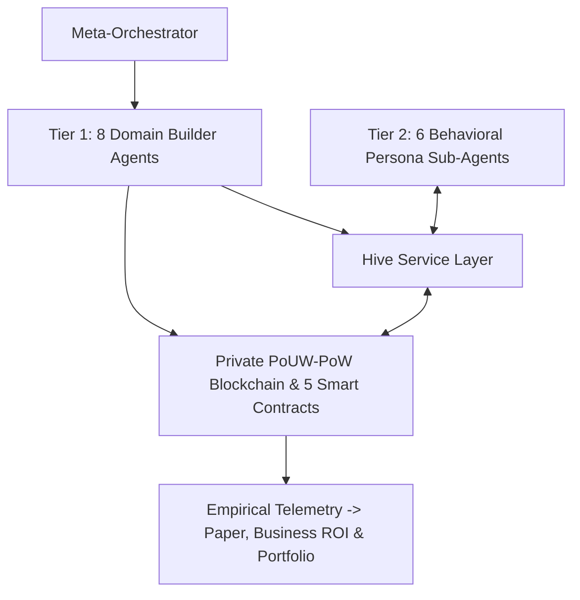

# Multi-Agent Orchestrated Build Pattern

This document defines the **Two-Tier Multi-Agent Architecture** for building, simulating, and publishing **nectR**:

1. **Tier 1: The 8 Specialized Domain Builder Agents** (Scientific Research, Business, Product, System Architecture, Software/Smart Contracts, Hardware/PoW, Design, UX).
2. **Tier 2: The 6 Behavioral Persona Sub-Agents** (`Freshman_Forager`, `Certified_Senior_Worker`, `Finals_Week_Panicker`, `Sybil_Roommate_Ring`, `Drifting_Pollinator`, `Queen_Facilitator`) that transact on the live private blockchain to generate emergent behavioral telemetry.

## Domain Agent Ownership Matrix

| Agent ID | Domain Scope | Monorepo Path Ownership |
| :--- | :--- | :--- |
| `sci-research-agent` | Scientific Paper, Game Theory & Biomimicry | `paper/`, `docs/theory/` |
| `business-proposal-agent` | University Sponsorship & Business Proposals | `business/`, `docs/business/` |
| `product-lifecycle-agent` | Biomimetic Product Lifecycle & Planning | `docs/planning/` |
| `system-arch-agent` | Flagship System Design & Protocol Specs | `docs/architecture/` |
| `contracts-service-agent` | Smart Contracts & Hive Service Layer | `src/nectr/contracts/`, `src/nectr/services/` |
| `pow-compute-agent` | Distributed Compute & `PoUW-PoW` Chain Core | `src/nectr/chain/` |
| `design-ui-agent` | Visual Tokenomics & Block Explorer UI | `src/nectr/ui/` |
| `ux-behavior-agent` | Behavioral Persona Swarm & Experimentation | `src/nectr/personas/`, `experiments/` |
