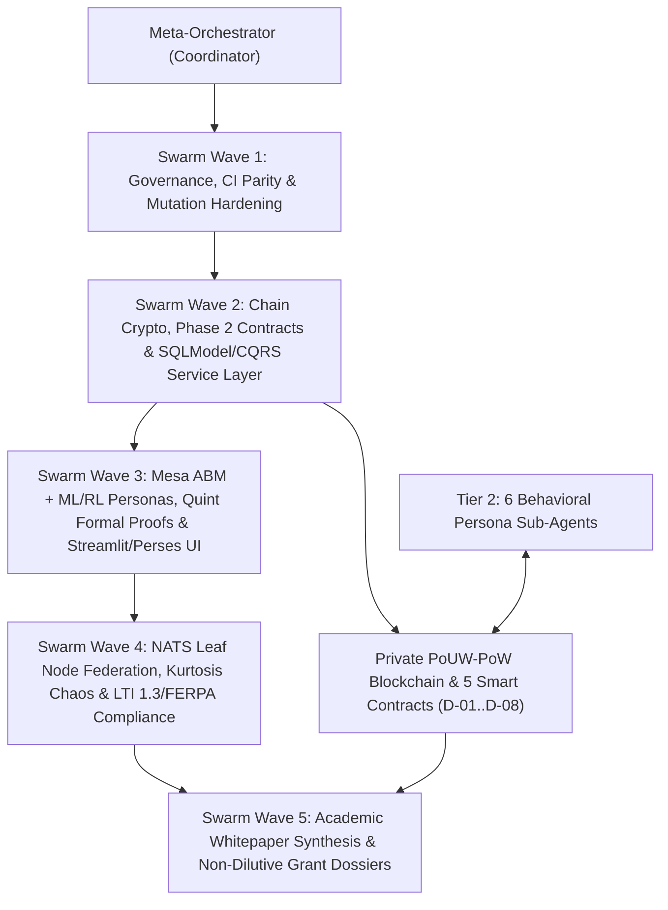

# Multi-Agent Swarm, `/teamwork` & Build Orchestration Playbook

This document defines the **Two-Tier Multi-Agent Architecture**, strict worktree/file ownership boundaries, and the **Five-Wave Swarm & `/teamwork` Build Plan** for developing, verifying, simulating, and publishing **nectR**.

---

## 1. Two-Tier Multi-Agent Architecture

1. **Tier 1 — The 8 Specialized Domain Builder Agents + `meta-orchestrator`:** Autonomous engineering, mathematical research, compliance, and verification agents that build the monorepo under strict Domain-Driven Design (`DDD`) file ownership boundaries.
2. **Tier 2 — The 6 Behavioral Persona Sub-Agents:** Domain actors (`FreshmanForagerPersona`, `CertifiedSeniorWorkerPersona`, `FinalsWeekPanickerPersona`, `SybilRoommateRingPersona`, `DriftingPollinatorPersona`, `QueenFacilitatorPersona`) orchestrated via seeded `Mesa` ABM (`ADR-0010`) that execute real Ed25519-signed transactions against the private blockchain to generate emergent economic telemetry.



---

## 2. Domain Agent Ownership & Worktree Isolation Matrix

To guarantee zero git cross-contamination during concurrent `/teamwork`, `swarm`, `invoke_subagent`, or `run_workflow` builds:

- **Isolated Worktree per Worker:** Every parallel builder agent runs in its own isolated repository worktree (`workspace: "share"` or Worktrunk `.worktrees/<branch-slug>`).
- **Explicit File Staging Only:** Agents MUST only run `git add <explicit-owned-file>` within their assigned domain scope. Running `git add .` or `git commit -a` is strictly prohibited (`DEC-006`).
- **Outside-In Red-Green-Refactor Sequence:** Every worker executes Phase 1 (`RED` with `@pytest.mark.xfail(strict=True)`), Phase 2 (`GREEN` observing `XPASS` failure before removing `xfail`/`@red`), and Phase 3 (`REFACTOR` passing `verify_orchestration_gate.py`).

| Agent ID | Domain Scope | Monorepo Path Ownership | Primary Verification Gate |
| :--- | :--- | :--- | :--- |
| `meta-orchestrator` | Governance, CI Parity, DevTools & Worktree Merges | `src/nectr/devtools/`, `.github/workflows/`, `.githooks/`, `.pre-commit-config.yaml`, `pyproject.toml` | `nectr-decisions check`, `nectr-citations check`, `nectr-docs check`, `spec_links` |
| `sci-research-agent` | Academic Whitepaper, Game Theory, Biomimicry & Provenance | `paper/`, `docs/theory/` | `verify_theory_docs.py`, `nectr-citations check`, `mkdocs build --strict` |
| `business-proposal-agent` | University Sponsorship ROI, FERPA/Title IV Compliance & Grants | `business/`, `docs/business/` | `mkdocs build --strict`, `pymarkdown scan docs/business` |
| `product-lifecycle-agent` | Biomimetic Product Lifecycle, Roadmap & Decision Registry | `docs/planning/`, `openspec/` | `nectr-decisions check`, `nectr.devtools.spec_links` |
| `system-arch-agent` | Flagship System Design, ADRs & Quint/TLA+ Formal Specs | `docs/architecture/`, `docs/adr/`, `specs/quint/` | `adrlint lint`, `adrlint lock --check`, `mkdocs build --strict` |
| `pow-compute-agent` | Cryptographic Primitives, Merkle Trees & `PoUW-PoW` Chain Core | `src/nectr/chain/`, `tests/test_chain*.py`, `features/chain_crypto_ledger.feature` | `verify_architecture_gate.py`, `pytest`, `behave` |
| `contracts-service-agent` | 5 Deterministic Smart Contracts, CQRS Service Layer & NATS Bridge | `src/nectr/contracts/`, `src/nectr/services/`, `tests/test_invariants.py`, `tests/test_hive_persistence_api.py` | `verify_architecture_gate.py`, `pytest`, `behave` |
| `ux-behavior-agent` | 6 Behavioral Persona Sub-Agents (`Mesa` ABM + ML/RL) & Experiments | `src/nectr/personas/`, `experiments/`, `docs/experiments/`, `tests/test_persona*.py` | `verify_persona_telemetry.py`, `pytest`, `behave` |
| `design-ui-agent` | Read-Only `Streamlit` Explorer & `Perses`/OTLP Dashboards | `src/nectr/ui/`, `tests/test_telemetry_ui.py`, `features/telemetry_ui.feature` | `pytest`, `behave`, zero `HiveContractEngine` write imports |

---

## 3. Five-Wave Multi-Agent Swarm & `/teamwork` Build Plan

Each build wave below is designed for parallel execution via `/teamwork`, `swarm` (`workspace: "share"`), or `run_workflow`, with non-overlapping file ownership across workers.

### Swarm Wave 1: Governance, CI Parity & Mutation Hardening (2 Parallel Workers)

| Swarm Worker Roster Name | Assigned Role & OpenSpec Change | Owned Files & Paths | Definition of Done (`GREEN` Gate) |
| :--- | :--- | :--- | :--- |
| `wave1-ci-parity` | `meta-orchestrator` — `add-github-actions-and-schema-hooks` | `src/nectr/devtools/ci_parity.py`, `docs/planning/decisions.schema.json`, `.github/workflows/`, `tests/test_ci_parity.py`, `features/ci_and_hook_parity.feature` | `check-jsonschema`, `lychee`, uv-locked matrix (`3.11`–`3.13`), and `--forbid-red` parity pass 100%. |
| `wave1-worktree-mutation` | `meta-orchestrator` — `adopt-worktrees-and-mutation-testing` | `src/nectr/devtools/mutation_gate.py`, `.config/wt.toml`, `tests/test_dev_workflow.py`, `features/dev_workflow.feature` | Worktrunk isolation and tiered changed-line mutation score floors pass 100%. |

### Swarm Wave 2: Cryptographic Chain, Phase 2 Biomimetic Contracts & Hexagonal Persistence (3 Parallel Workers)

| Swarm Worker Roster Name | Assigned Role & OpenSpec Change | Owned Files & Paths | Definition of Done (`GREEN` Gate) |
| :--- | :--- | :--- | :--- |
| `wave2-chain-crypto` | `pow-compute-agent` — `adopt-ed25519-and-pymerkle` | `src/nectr/chain/`, `tests/test_chain_crypto.py`, `features/chain_crypto_ledger.feature`, `features/steps/chain_crypto_ledger_steps.py` | `SignerPort` (`PyNaCl`/`cryptography` Ed25519), `CanonicalCodecPort` (`rfc8785`/`canonicaljson`), `MerkleAccumulatorPort` (`merklelib`/`remerkleable` + `0x00`/`0x01` SMT), and Transcript-Oracle `PoUW-PoW` pass with `@red` removed. |
| `wave2-biomimetic-fsm` | `contracts-service-agent` — `add-biomimetic-lifecycle-and-swarming-contracts` | `src/nectr/contracts/`, `tests/test_invariants.py`, `features/protocol_invariants.feature`, `features/steps/protocol_invariants_steps.py` | `icontract` invariants `D-01`–`D-08`, Lazy Demurrage (`DEC-001`), Waggle `60%` Co-Pay (`DEC-002`), Tremble/Stop-Signals (`DEC-013`), Khoury Circuit Breaker (`D-07`), 3-Door Senior Sinks (`DEC-004`), and 15-Scout Swarm Bivouac Escrow (`DEC-012`) pass 100%. |
| `wave2-service-cqrs` | `contracts-service-agent` — `add-sqlmodel-persistence-and-api` | `src/nectr/services/`, `tests/test_hive_persistence_api.py`, `features/hive_persistence_api.feature`, `features/steps/hive_persistence_api_steps.py` | `HiveRepositoryPort` (`SQLModel` + `Alembic` / deterministic WAL snapshots), `FastAPI` router, `structlog` + `OpenTelemetry`, and off-chain `CQRSGraphProjector` (`ADR-0014`) pass with `@red` removed. |

### Swarm Wave 3: Mesa ABM + ML/RL Personas, Quint Formal Proofs & Telemetry UI (3 Parallel Workers)

| Swarm Worker Roster Name | Assigned Role & OpenSpec Change | Owned Files & Paths | Definition of Done (`GREEN` Gate) |
| :--- | :--- | :--- | :--- |
| `wave3-persona-abm` | `ux-behavior-agent` — `adopt-mesa-abm-and-hypothesis` | `src/nectr/personas/`, `experiments/`, `tests/test_persona_mesa_and_hypothesis.py`, `features/persona_abm_simulation.feature`, `features/steps/persona_abm_simulation_steps.py` | Seeded `HiveMesaModel`, `GraphTelemetryPort` (`networkx`/`NetworKit`/`rustworkx`), `Hypothesis` `RuleBasedStateMachine`, and `EXP-001`–`EXP-004` simulation runs pass with `@red` removed. |
| `wave3-telemetry-ui` | `design-ui-agent` — `add-telemetry-dashboard-ui` | `src/nectr/ui/`, `tests/test_telemetry_ui.py`, `features/telemetry_ui.feature`, `features/steps/telemetry_ui_steps.py` | Read-only `Streamlit` + `NetworkX` panels (`ADR-0011`) and `Prometheus` OTLP + Apache-2.0 **Perses** dashboard specs (`DEC-014`) pass with `@red` removed and zero contract-write imports. |
| `wave3-quint-formal` | `system-arch-agent` — Formal Invariant Verification | `specs/quint/`, `docs/architecture/smart_contracts.md` | `quint run` and `quint verify` prove temporal safety of `D-01`–`D-08` and export deterministic JSON trace fixtures replayed in `pytest`/`behave`. |

### Swarm Wave 4: NATS Leaf Node Federation, Kurtosis Chaos Testbed & Campus Compliance (2 Parallel Workers)

| Swarm Worker Roster Name | Assigned Role & OpenSpec Change | Owned Files & Paths | Definition of Done (`GREEN` Gate) |
| :--- | :--- | :--- | :--- |
| `wave4-nats-chaos` | `contracts-service-agent` — `add-nats-jetstream-cross-hive-federation` | `src/nectr/services/federation.py`, `experiments/scenarios/exp005_nats_partition/`, `tests/test_nats_federation.py` | Outbound NATS Leaf Node (`port 7422`) + JetStream Domain proof mirroring (`ADR-0014`), monthly export quotas, and Kurtosis + Pumba/Toxiproxy `EXP-005` partition recovery pass 100%. |
| `wave4-campus-compliance` | `business-proposal-agent` — `add-campus-compliance-lti-and-zk-identity` | `src/nectr/services/compliance.py`, `business/`, `tests/test_campus_compliance.py` | `ZeroPiiCommitmentGuard` (FERPA/GDPR salted hashes + BBS+ ZK verifier port), `TitleIvComplianceFirewall`, `CampusIdentityPort` (LTI 1.3 `NRPS` + Shibboleth SAML 2.0), and HECVAT 4.1.6 / DCO 1.1 artifacts pass (`ADR-0015`). |

### Swarm Wave 5: Academic Whitepaper Synthesis & Non-Dilutive Grant Package Swarm (2 Parallel Workers)

| Swarm Worker Roster Name | Assigned Role & OpenSpec Change | Owned Files & Paths | Definition of Done (`GREEN` Gate) |
| :--- | :--- | :--- | :--- |
| `wave5-whitepaper` | `sci-research-agent` — Milestone 4 Whitepaper Compilation | `paper/nectR_whitepaper.md`, `paper/references.yaml`, `paper/lineage.yaml`, `docs/theory/provenance_lineage.md` | Complete 10-section manuscript embedding reproducible `experiments/results/` figures and passing `verify_theory_docs.py` and `nectr-citations check` (`>= 75%` peer-reviewed). |
| `wave5-grant-dossiers` | `business-proposal-agent` — Milestone 4 & 5 Grant & Pilot Packages | `business/university_sponsorship_proposal.md`, `business/grants/`, `docs/business/institutional_proposal.md` | Complete `$42.50/hr` $\rightarrow$ `$3.33/hr` ROI model, 2-page Campus CIO TCO Brief, Apereo incubation dossier, and grant narratives for `NSF PESOSE`, `NSF IUSE`, `NSF Future CoRe`, `RSF/J-PAL`, `Sloan`, and `EF ESP`. |

---

## 4. Pre-Merge Swarm Coordinator Verification Protocol

Before the `meta-orchestrator` merges any swarm worker branch into `main`, the worker branch MUST exit `0` on the unified orchestration gate:

```powershell
uv run python .agents/skills/orchestrate-nectr/scripts/verify_orchestration_gate.py
uv run python .agents/skills/security-privacy-guard/scripts/run_security_audit.py --mode full
uv run adrlint lint
uv run adrlint lock --check
uv run nectr-decisions check
uv run nectr-citations check
uv run nectr-docs check
uv run python -m nectr.devtools.spec_links
uv run mkdocs build --strict
uv run pytest
uv run behave
```
