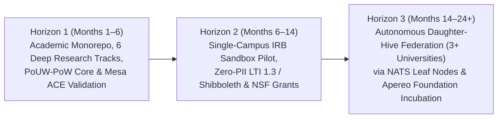

# Long-Term Product Vision, Roadmap & Autonomous Development Milestones

## Three-Horizon Product Vision & North Star (2026–2029)

**nectR** evolves across three disciplined horizons from an open-source academic mechanism-design monorepo into a federated, non-speculative Digital Public Good (`DPG`) incubated under higher-education foundation stewardship:

1. **Horizon 1 — Formal Theory, Deterministic Core & Empirical ACE Testbed (Months 1–6: Nov 2026–Apr 2027):**
   Prove the *Apis mellifera* biomimetic and game-theoretic mechanisms mathematically (`paper/`, `docs/theory/`), harden the private `PoUW-PoW` blockchain and 5 deterministic smart contracts (`D-01`–`D-08`), execute reproducible 15-week semester Monte Carlo and adversarial simulations (`EXP-001`–`EXP-005`), and submit parallel non-dilutive research grant proposals (`NSF IUSE`, `NSF Future CoRe`, `NSF PESOSE Track 1`, `NSF DRMS`, `RSF/J-PAL`, `Sloan`, `EF ESP`).
2. **Horizon 2 — Zero-PII Campus Compliance & Single-Campus IRB Sandbox Pilot (Months 6–14: Mid-2027–Early 2028):**
   Abstract all blockchain keys behind **InCommon Shibboleth SAML 2.0** and **1EdTech LTI 1.3 (`NRPS`)** inside Canvas/Moodle, enforce the **Zero-PII FERPA/GDPR** hybrid boundary and **IRS Pub 970 / Title IV non-monetary service-duration credit firewall** (`ADR-0015`), complete **EDUCAUSE HECVAT 4 (`v4.1.6`)**, and run a one-semester matched-cohort IRB pilot across 2–3 high-DFW gateway STEM courses.
3. **Horizon 3 — Multi-Campus Autonomous Swarming & Apereo Foundation Stewardship (Months 14–24+: 2028–2029):**
   Onboard 3+ partner universities as autonomous daughter Hives federated via outbound **NATS Leaf Nodes (port `7422`) and JetStream Domains** (`ADR-0014`), graduate governance from the Stage 1 Multi-Campus Academic Consortium into **Apereo Foundation `501(c)(3)` incubation** (`DEC-015`), and unlock scale funding (`NSF PESOSE Track 2/3 $1.5M`, `NSF IUSE Level 2/3 $2M`, `Horizon Europe`, and `Sovereign Tech Agency`).

---

## Milestone 0: Open-Source Hygiene, Governance, Formal Verification & CI Parity

- [x] **Security, Secret & Local-Path Hygiene:** Configured `detect-secrets` (`.secrets.baseline`), `pygrep`/hook local-path guards, `.githooks/` (`pre-commit`, `commit-msg`, `pre-push`), and `.pre-commit-config.yaml`.
- [x] **Open-Source-First & Transitive License Audit:** Enforced permissive-license-only rule and scheduled `pip-licenses` + `pip-audit` + CycloneDX SBOM (`.github/workflows/license-and-security-scan.yml`) + Dependabot (`.github/dependabot.yml`).
- [x] **OpenSpec + Behave BDD + Strict TDD (`xfail_strict`) + `adrlint` Governance:** Enforced `adrlint` (MADR 4.0 + `adrlint.lock`) and `nectr.devtools.decisions check` (`decisions.yaml` + verbosity limits), `nectr.devtools.spec_links` (no hardcoded scenarios in `spec.md`), `commitizen` (`cz check` / `cz changelog`), and `.github/workflows/roadmap-and-changelog.yml`.
- [x] **Repo Normalization & `.gitattributes` ([#8](https://github.com/brandon-fox/nectR/issues/8)):** Enforce LF line endings, `ruff format --check`, and Markdown linting (`pymarkdownlnt`) in pre-commit & CI before legacy diffs accumulate.
- [x] **Replace `pyadr` with OSS `adrlint` & Persona Dependency Split ([#6](https://github.com/brandon-fox/nectR/issues/6), [#10](https://github.com/brandon-fox/nectR/issues/10)):** Adopted MIT OSS `adrlint` (`.adrlint.toml` + `adrlint.lock`, zero CVEs, zero custom ADR engine code) dropping `cleo 0.8.1` (`PYSEC-2022-43178`) and `text-unidecode`, and split `pyproject.toml` `dev` extras by user persona (`test`, `lint`, `security`, `docs`, `research`, `dev`).
- [x] **Git Tracking & MADR Workflow Polish ([#5](https://github.com/brandon-fox/nectR/issues/5), [#11](https://github.com/brandon-fox/nectR/issues/11)):** Untracked `HANDOFF.md` (`git rm --cached`) so `.gitignore` applies, added `--allow-proposed` branch checks alongside `adrlint`, and consolidated workflow & index docs in `docs/adr/index.md`.
- [x] **Worktrunk Worktree Isolation & Incremental Poodle Mutation Gate (`adopt-worktrees-and-mutation-testing`, `ADR-0016`, `ADR-0017`, `DEC-016`):** Configured isolated `.worktrees/` environments via `.config/wt.toml` (`--no-squash` merges), banned `src/` mutation pragmas in `pre-commit`, and enforced diff-scoped Poodle targets (`>= 85%` Tier 1, `>= 75%` Tier 2) plus upward-only `[tool.nectr.mutation.baseline]` floors in `pre-push`, `pre-merge`, and `.github/workflows/mutation-testing.yml`.
- [ ] **CI/Hook Parity & Survivor Hardening (`add-github-actions-and-schema-hooks`, `harden-mutation-survivors`):** Enforce `check-jsonschema`, `lychee` broken-link checks, `@red` main-branch guard, and eliminate pre-existing Tier-1/Tier-2 mutation survivors up to target floors without inline pragmas.
- [ ] **Phase 2 (Automated Issue Creation on License Drift/Flag):** Open/deduplicate labeled GitHub Issues (`license-violation`, `cve-alert`) via `actions/github-script` when scheduled scans fail.
- [ ] **Phase 3 (Downstream Agent Auto-Remediation):** Trigger isolated off-chain agent PR workflow (`ADR-0013`) on `license-violation` issues under strict OpenSpec $\rightarrow$ BDD $\rightarrow$ TDD gates.

---

## Milestone 1: Theoretical Foundation, Six Deep Research Syntheses & Provenance Custody

- [x] **Archive All 6 Foundational Deep Research Reports in [`docs/theory/research/`](../theory/research/federated_barter_tokenomics.md):**
  - [x] Track 1: [Federated Barter Economy Tokenomics Design](../theory/research/federated_barter_tokenomics.md)
  - [x] Track 2: [Student Tutoring Barter Mechanism Design](../theory/research/student_tutoring_mechanism_design.md)
  - [x] Track 3: [Biomimetic Hive Economics For nectR](../theory/research/biomimetic_hive_economics.md)
  - [x] Track 4: [Permissive Tooling & Formal Verification Survey](../theory/research/permissive_tooling_survey_for_nectR.md)
  - [x] Track 5: [Federated PoUW-PoW & NATS Infrastructure](../theory/research/federated_PoUW-PoW_blockchain_infrastructure.md)
  - [x] Track 6: [Non-Dilutive Funding & Campus Pilot Strategy](../theory/research/nectR_funding_and_pilot_strategy.md)
- [x] **Lock Architectural Decisions (`ADR-0001`–`ADR-0015`) & Fast Operational Rules (`DEC-001`–`DEC-015`, `EXP-001`–`EXP-005`):** Completed `/grill-me` synthesis across tokenomics, governance, permissive tooling, NATS Leaf Node / CQRS isolation (`ADR-0014`), and Zero-PII FERPA/GDPR/Title IV compliance (`ADR-0015`).
- [x] **Citation Validation & Provenance Chain-of-Custody ([#7](https://github.com/brandon-fox/nectR/issues/7)):** Expanded `paper/references.yaml` (`27` external references, `88.9%` peer-reviewed floor) and `paper/lineage.yaml` (`36` DAG edges) with automated downstream quarantine & rebuild flagging (`nectr-citations`).
- [x] **Formalize Biomimetic & Game-Theoretic Specifications:** Expanded [`docs/theory/biomimicry_model.md`](../theory/biomimicry_model.md), [`docs/theory/tokenomics_game_theory.md`](../theory/tokenomics_game_theory.md), and [`docs/theory/whitepaper_outline.md`](../theory/whitepaper_outline.md) with 1-to-1 ODEs, payoff matrices, Spence separating thresholds, and duplex `PoUW-PoW` security proofs.

---

## Milestone 2: Private `PoUW-PoW` Blockchain, 5 Smart Contracts & Federated Service Layer

- [ ] **Wave 2A — Cryptographic & Merkle Ports + Transcript-Oracle `PoUW-PoW` (`src/nectr/chain/`, `adopt-ed25519-and-pymerkle`):**
  - Implement `SignerPort` (`PyNaCl` / `cryptography` Ed25519), `CanonicalCodecPort` (`rfc8785` / `canonicaljson`), and `MerkleAccumulatorPort` (`merklelib` / `remerkleable` + `0x00`/`0x01` domain-separated Sparse Merkle Tree) (`ADR-0008`).
  - Couple Transcript-Oracle `PoUW-PoW` difficulty ($\Delta_{\text{sec}} > 0$, `ball_2018`) to the capped Comb Compute Jar (`ADR-0007`).
- [ ] **Wave 2B — Extended Biomimetic Lifecycle & Swarming Smart Contracts (`src/nectr/contracts/`, `add-biomimetic-lifecycle-and-swarming-contracts`):**
  - Decorate `HiveContractEngine` with `icontract` Design-by-Contract invariants (`D-01`–`D-08`) and formalize `specs/quint/hive_invariants.qnt` (Quint / TLA+ / Apalache).
  - Implement `DemurrageAccumulator` (`DEC-001`), `WaggleTrembleController` (`DEC-002`, `DEC-013`), `QMPHealthAndSupersedureFSM`, `TemporalPolyethismGovernor` (Khoury Precocious Promotion Circuit Breaker, `D-07`), 3-door Senior graduation sinks (`DEC-004`), and `SwarmBivouacEscrow` (`6.25x–8.0x` Honey-to-Wax burn + 15-Scout Quorum Sensing, `DEC-012`, `D-08`).
- [ ] **Wave 2C — Hexagonal Persistence, CQRS Graph Read Model & FastAPI (`src/nectr/services/`, `add-sqlmodel-persistence-and-api`):**
  - Implement `HiveRepositoryPort` with `SQLModel` + `Alembic` (and strict single-writer WAL snapshot mode banning SQL wall-clock functions), `FastAPI` endpoints, and `structlog` + `OpenTelemetry` tracing (`ADR-0009`).
  - Isolate `networkx`/`NetworKit`/`rustworkx` Knowledge Graph analytics in an asynchronous post-commit CQRS projector while committing only the 32-byte `kg_root` on-chain (`ADR-0014`).
- [ ] **Wave 2D — Outbound NATS Leaf Node Federation & Kurtosis Chaos Testbed (`add-nats-jetstream-cross-hive-federation`):**
  - Implement `CrossHiveBridgePort` over `nats-py` Leaf Nodes (outbound TLS port `7422`) and per-Hive JetStream Domains (`ADR-0014`).
  - Package reproducible multi-Hive fault-injection enclaves with post-June-2024 Apache-2.0 **Kurtosis** + **Pumba** (`tc netem`) / **Toxiproxy** (`DEC-014`).

---

## Milestone 3: Behavioral Persona Swarm, 15-Week Semester ACE & Telemetry UI

- [ ] **Wave 3A — Seeded Mesa ABM & Hypothesis State-Machine Fuzzing (`src/nectr/personas/`, `adopt-mesa-abm-and-hypothesis`):**
  - Implement `HiveMesaModel` and `PersonaBeeAgent` for all 6 archetypes (`ADR-0010`, `DEC-009`), backed by `GraphTelemetryPort` (`networkx`, `NetworKit`, `rustworkx`) and `Hypothesis` `RuleBasedStateMachine` invariant fuzzing.
- [ ] **Wave 3B — Experimental Matrix (`EXP-001`–`EXP-005`) & Adaptive ML/RL Track (`experiments/`):**
  - Execute multi-semester Monte Carlo sweeps and contextual multi-armed bandit / RL stress tests across `EXP-001` (Queen Nepotism vs. Honest Praise), `EXP-002` (15-Week Finals Crunch & `60%` Waggle Co-Pay), `EXP-003` (Pairwise + `COCM` Dorm-Cluster Sybil Bound), `EXP-004` (Khoury Mortality Shock & Circuit Breaker), and `EXP-005` (NATS WAN Partition Recovery).
- [ ] **Wave 3C — Read-Only Telemetry Dashboard & Apache-2.0 Perses Observability (`src/nectr/ui/`, `add-telemetry-dashboard-ui`):**
  - Build the read-only `Streamlit` + `NetworkX` Hive Explorer (`ADR-0011`), configure `Prometheus` OTLP + **Perses (`Apache-2.0`)** multi-Hive dashboards (`DEC-014`), and export immutable CSV/Parquet paper artifacts.

---

## Milestone 4: Academic Paper, Non-Dilutive Grant Pipeline & Flagship Portfolio

- [x] **Living Docs, Glossary & IDE-Agnostic Onboarding ([#9](https://github.com/brandon-fox/nectR/issues/9), [#12](https://github.com/brandon-fox/nectR/issues/12)):** Added `docs/glossary.md` defining `MV=PQ` & `PoUW-PoW`, made `README.md` IDE/skill-agnostic, and automated `README.md` spaces & `mkdocs.yml` `nav:` generation/drift checks (`nectr-docs`).
- [ ] **Compile Publication-Ready Whitepaper (`paper/nectR_whitepaper.md`):** Author the 10-section manuscript following [`docs/theory/whitepaper_outline.md`](../theory/whitepaper_outline.md) with 100% verified `nectr-citations check` custody and empirical figures from `experiments/`.
- [ ] **Finalize Institutional ROI & Grant Submission Dossiers (`business/`, `docs/business/institutional_proposal.md`):**
  - Package the 10,000-student university ROI calculator (`$42.50/hr` $\rightarrow$ `$3.33/hr`, `2.40` break-even retained freshmen, `1,150%` Year-1 ROI).
  - Prepare Q1 2027 non-dilutive grant submissions: **NSF IUSE: EDU** (`Jan 20, 2027`), **NSF Future CoRe (`CISE`)** (`Feb 4, 2027`), **Ethereum Foundation `ESP`** (`Feb 2027`), **NSF PESOSE Track 1** (`Mar 2, 2027`), **NSF DRMS**, **Russell Sage Foundation (+ J-PAL)**, and **Alfred P. Sloan Foundation**.
- [ ] **Publish System Design Portfolio Site:** Verify and deploy via `uv run mkdocs build --strict`.

---

## Milestone 5: University IRB Sandbox Pilot, LTI 1.3 Integration & Apereo Incubation (Months 6–24)

- [ ] **Complete the 8-Point University Pilot Readiness Checklist (`add-campus-compliance-lti-and-zk-identity`, `ADR-0015`, `DEC-015`):**
  - [ ] Enforce **MIT License + DCO 1.1** (`CONTRIBUTING.md` + SSH-signed commits) and host TTO Bayh-Dole clearance.
  - [ ] Implement `ZeroPiiCommitmentGuard` (off-chain campus relational PII DB + on-chain salted hashes / BBS+ ZK membership proofs + reusable GDPR DPIA).
  - [ ] Implement `TitleIvComplianceFirewall` (non-monetary organizer-cleared service-duration credit mode + optional Payroll/OSFAS adapter).
  - [ ] Implement `CampusIdentityPort` for **1EdTech LTI 1.3 (`NRPS` + Deep Linking 2.0)** and **InCommon Shibboleth SAML 2.0 SSO** with SCIM term-rollover deprovisioning.
  - [ ] Complete **EDUCAUSE HECVAT 4 (`v4.1.6`)** workbook and 2-page Campus CIO Total Cost of Ownership (`TCO`) Brief.
- [ ] **Stage 1 Single-Campus IRB Sandbox Pilot (Months 6–14):** Deploy inside one host university Learning Center across 2–3 high-DFW gateway STEM courses (`CALC-101`, `CS-101`, `CHEM-101`) and measure causal retention and cost-per-hour lift against `EXP-002` predictions.
- [ ] **Stage 2 Multi-Campus Daughter-Hive Federation & Apereo Foundation Incubation (Months 14–24+):** Spawn 2–4 partner university daughter Hives via 15-Scout Quorum Sensing (`DEC-012`) over NATS Leaf Nodes (`ADR-0014`), transition governance into the **Apereo Foundation** (`501(c)(3)`), and submit Stage 2 scale proposals (`NSF PESOSE Track 2/3`, `NSF IUSE Level 2/3`, `Horizon Europe`, `Sovereign Tech Agency`).
