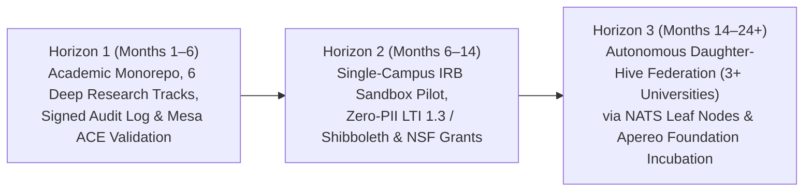

# Product Vision & Three-Horizon North Star (2026–2029)

**nectR** evolves across three disciplined horizons from an open-source academic mechanism-design monorepo into a federated, non-speculative Digital Public Good (`DPG`) incubated under higher-education foundation stewardship:

## The Three Horizons

1. **Horizon 1 — Formal Theory, Deterministic Core & Empirical ACE Testbed (Months 1–6: Nov 2026–Apr 2027):**
   Prove the *Apis mellifera* biomimetic and game-theoretic mechanisms mathematically (`paper/`, `docs/theory/`), harden the signed audit log blockchain and 5 deterministic smart contracts (`D-01`–`D-08`), execute reproducible 15-week semester Monte Carlo and adversarial simulations (`EXP-001`–`EXP-005`), and submit parallel non-dilutive research grant proposals (`NSF IUSE`, `NSF Future CoRe`, `NSF PESOSE Track 1`, `NSF DRMS`, `RSF/J-PAL`, `Sloan`, `EF ESP`).
2. **Horizon 2 — Zero-PII Campus Compliance & Single-Campus IRB Sandbox Pilot (Months 6–14: Mid-2027–Early 2028):**
   Abstract all blockchain keys behind **InCommon Shibboleth SAML 2.0** and **1EdTech LTI 1.3 (`NRPS`)** inside Canvas/Moodle, enforce the **Zero-PII FERPA/GDPR** hybrid boundary and **IRS Pub 970 / Title IV non-monetary service-duration credit firewall** (`ADR-0015`), complete **EDUCAUSE HECVAT 4 (`v4.1.6`)**, and run a one-semester matched-cohort IRB pilot across 2–3 high-DFW gateway STEM courses.
3. **Horizon 3 — Multi-Campus Autonomous Swarming & Apereo Foundation Stewardship (Months 14–24+: 2028–2029):**
   Onboard 3+ partner universities as autonomous daughter Hives federated via outbound **NATS Leaf Nodes (port `7422`) and JetStream Domains** (`ADR-0014`), graduate governance from the Stage 1 Multi-Campus Academic Consortium into **Apereo Foundation `501(c)(3)` incubation** (`DEC-015`), and unlock scale funding (`NSF PESOSE Track 2/3 $1.5M`, `NSF IUSE Level 2/3 $2M`, `Horizon Europe`, and `Sovereign Tech Agency`).

---

## Post-v0.1.0 Roadmap Milestones

### Milestone 2: Multi-Hive Protocol Federation & Chaos Testbeds

- **Wave 2A — Cryptographic & Merkle Ports + Signed Audit Log Compute Verification:** Deterministic `UsefulComputeProof` verification (`ADR-0019`) bound to the capped Comb Compute Jar.
- **Wave 2B — Core Smart Contracts on Zero-Gas EVM & Swarming Extensions:** Formal Quint/TLA+ invariants, Lazy Demurrage (`DEC-001`), Waggle `60%` Co-Pay (`DEC-002`), and 3-door Senior graduation sinks (`DEC-004`).
- **Wave 2C — Canonical SQLModel Block-Log Replay & CQRS Graph Projection:** Event-sourced graph read models outside consensus (`ADR-0014`).
- **Wave 2D — Outbound NATS Leaf Node Federation & Kurtosis Chaos Testbeds:** Asymmetric campus NAT/firewall traversal on outbound TLS port 7422.

### Milestone 3: Behavioral Persona Swarm, 15-Week Semester ACE & Telemetry UI

- **Wave 3A — Seeded Mesa ABM & Hypothesis Invariant Fuzzing (`src/nectr/personas/`, `adopt-mesa-abm-and-hypothesis`):** Implement `HiveMesaModel` and `PersonaBeeAgent` for all 6 archetypes (`ADR-0010`, `DEC-009` over LLM/workflow frameworks CrewAI/n8n, formerly k8n), backed by `GraphTelemetryPort` (`networkx`, `NetworKit`, `rustworkx`) and `Hypothesis` invariant fuzzing.
- **Wave 3B — Experimental Matrix (`EXP-001`–`EXP-006`) & Workflow Options (`experiments/`):**
  - Execute multi-semester Monte Carlo sweeps across `EXP-001` through `EXP-006`.
  - *Option A (Locked Default — Pure Mesa ABM + ML/RL):* Deterministic seeded `mesa` Monte Carlo sweeps and `hypothesis` fuzzing (`DEC-009`).
  - *Option B (Sidecar `n8n` Webhook Runner):* Self-hosted `n8n` triggers scheduled sweeps via `HiveServiceLayer` APIs (`ADR-0016`).
  - *Option C (Permissive-OSS Alternatives, `DEC-007`):* Evaluate `Activepieces` (`MIT`) for visual webhook flows, `Kestra` / `Prefect` (`Apache-2.0`) for reproducible experiment DAGs, and `Temporal` (`MIT`) for durable orchestration.
  - *Option D (Hybrid Benchmark Arm, `EXP-006`):* Compare seeded Mesa baselines against external `n8n`/Activepieces-triggered runs.
- **Wave 3C — Read-Only Telemetry Dashboard:** Streamlit + NetworkX explorer (`ADR-0011`) and Prometheus/Perses observability.

### Milestone 4: Academic Whitepaper & Non-Dilutive Grant Dossiers

- **JASSS / JEBO Manuscript (`ODD+D` Protocol):** Whitepaper submission with 100% verified citation chain of custody (`paper/nectR_whitepaper.md`).
- **Grant Submissions:** NSF DRMS, Russell Sage Foundation / J-PAL RCT, NSF IUSE, NSF Future CoRe, Sloan Foundation.

### Milestone 5: University IRB Sandbox Pilot, LTI 1.3 Integration & Apereo Incubation (Months 6–24)

- **Pilot Readiness Checklist:** Zero-PII Canvas/Moodle integration, HECVAT 4.1.6 compliance, and Apereo Foundation incubation.
