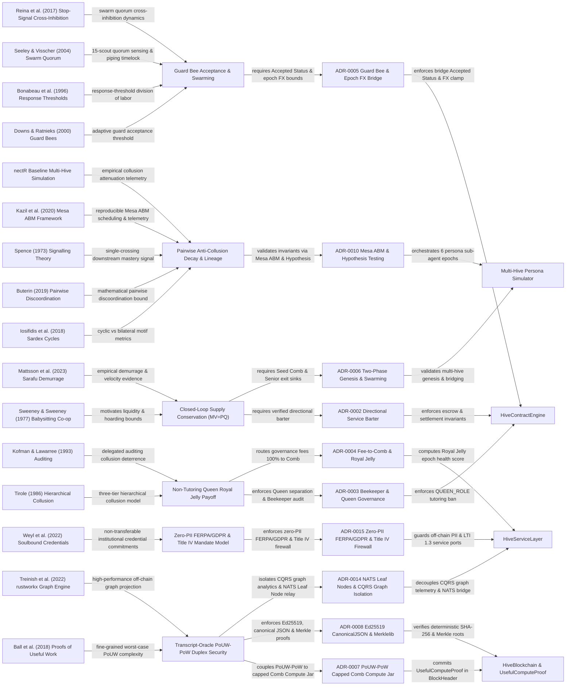

<!-- AUTO-GENERATED by `nectr-citations render` from `paper/references.yaml` & `paper/lineage.yaml`. Do not edit manually. -->

# Citation Quality & Provenance Chain-of-Custody

This report links canonical primary literature through mathematical theory, architectural decisions, and production code/tests so source flaws trigger deterministic downstream rebuild flags.

## Evidence Quality Scorecard

| Metric | Observed Value | Required Threshold |
| :--- | :---: | :---: |
| External References | `27` | `>= 1` |
| Peer-Reviewed Ratio | `88.9%` (`24/27`) | `>= 70.0%` |
| Quarantined / Flagged Sources | `0` | `0` (strict mode) |
| Lineage Edges Tracked | `36` | DAG verified |

## Lineage Graph (Sources → Theory → Decisions → Code)

## Downstream Quarantine & Rebuild Alerts

All canonical references passed plagiarism screening (`clean`) and custody checks (`verified`). No downstream rebuilds required.

## Chain-of-Custody Reference Ledger

| ID | Year | Type | Custody Agent | Plagiarism Screen | Identifier |
| :--- | :---: | :--- | :--- | :---: | :--- |
| `sweeney_1977` | 1977 | `peer-reviewed-journal` | `sci-research-agent` | `clean` | `10.2307/1991998` |
| `tirole_1986` | 1986 | `peer-reviewed-journal` | `sci-research-agent` | `clean` | `10.1093/oxfordjournals.jleo.a036907` |
| `kofman_lawarree_1993` | 1993 | `peer-reviewed-journal` | `sci-research-agent` | `clean` | `10.2307/2951721` |
| `spence_1973` | 1973 | `peer-reviewed-journal` | `sci-research-agent` | `clean` | `10.2307/1882010` |
| `filippas_2020` | 2022 | `peer-reviewed-journal` | `sci-research-agent` | `clean` | `10.1287/mksc.2022.1350` |
| `leung_2019` | 2019 | `peer-reviewed-journal` | `sci-research-agent` | `clean` | `10.1177/0143034318808832` |
| `nickow_2024` | 2024 | `peer-reviewed-journal` | `sci-research-agent` | `clean` | `10.3102/00028312231208687` |
| `gneezy_rustichini_2000` | 2000 | `peer-reviewed-journal` | `sci-research-agent` | `clean` | `10.1162/003355300554917` |
| `seeley_tovey_1994` | 1994 | `peer-reviewed-journal` | `sci-research-agent` | `clean` | `10.1006/anbe.1994.1044` |
| `camazine_sneyd_1991` | 1991 | `peer-reviewed-journal` | `sci-research-agent` | `clean` | `10.1016/S0022-5193(05)80098-0` |
| `bonabeau_1996` | 1996 | `peer-reviewed-journal` | `sci-research-agent` | `clean` | `10.1098/rspb.1996.0229` |
| `ratnieks_1988` | 1988 | `peer-reviewed-journal` | `sci-research-agent` | `clean` | `10.1086/284846` |
| `wenseleers_ratnieks_2006` | 2006 | `peer-reviewed-journal` | `sci-research-agent` | `clean` | `10.1086/508619` |
| `downs_ratnieks_2000` | 2000 | `peer-reviewed-journal` | `sci-research-agent` | `clean` | `10.1093/beheco/11.3.326` |
| `leoncini_2004` | 2004 | `peer-reviewed-journal` | `sci-research-agent` | `clean` | `10.1073/pnas.0407652101` |
| `khoury_2011` | 2011 | `peer-reviewed-journal` | `sci-research-agent` | `clean` | `10.1371/journal.pone.0018491` |
| `seeley_visscher_2004` | 2004 | `peer-reviewed-journal` | `sci-research-agent` | `clean` | `10.1051/apido:2004004` |
| `reina_2017` | 2017 | `peer-reviewed-journal` | `sci-research-agent` | `clean` | `10.1103/PhysRevE.95.052411` |
| `kamvar_2003` | 2003 | `conference-proceedings` | `sci-research-agent` | `clean` | `10.1145/775152.775242` |
| `mattsson_2023` | 2023 | `peer-reviewed-journal` | `sci-research-agent` | `clean` | `10.1038/s41598-023-33184-1` |
| `iosifidis_2018` | 2018 | `peer-reviewed-journal` | `sci-research-agent` | `clean` | `10.1038/s41562-018-0450-0` |
| `ball_2018` | 2018 | `conference-proceedings` | `pow-compute-agent` | `clean` | `10.1007/978-3-319-96884-1_26` |
| `kazil_2020` | 2020 | `conference-proceedings` | `ux-behavior-agent` | `clean` | `10.1007/978-3-030-61255-9_30` |
| `treinish_2022` | 2022 | `peer-reviewed-journal` | `system-arch-agent` | `clean` | `10.21105/joss.03968` |
| `buterin_2019` | 2019 | `technical-spec` | `sci-research-agent` | `clean` | `https://ethresear.ch/t/pairwise-coordination-subsidies-a-new-quadratic-funding-design/5553` |
| `saltini_2019` | 2019 | `preprint` | `system-arch-agent` | `clean` | `https://arxiv.org/abs/1909.10194` |
| `weyl_2022` | 2022 | `preprint` | `system-arch-agent` | `clean` | `10.2139/ssrn.4105763` |
| `nectr_sim_baseline_2026` | 2026 | `internal-experiment` | `ux-behavior-agent` | `clean` | `internal` |
